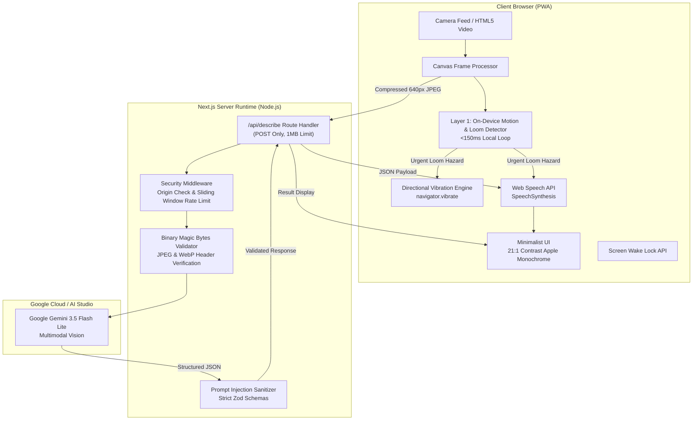

# System Architecture: Drishti AI

---

## 1. High-Level System Architecture

Drishti AI is architected as an autonomous sensory feedback loop with two distinct, complementary perception layers: an ultra-low-latency on-device motion/loom detector (<150ms) and a deep multimodal cloud vision model (~1.4s–2.0s).



---

## 2. The Two-Layer Vision System

Assistive technology for visually impaired users must balance two opposing constraints:
1. **Immediate Reaction Time:** Sudden approaching obstacles (doors swinging open, people walking into the path) require reaction times well under 500ms to prevent collisions.
2. **Deep Semantic Understanding:** Recognizing that an object is a "laptop on a desk" or reading a sign requires large multimodal neural networks that inherently involve network roundtrips.

Drishti resolves this dilemma via a dual-layer architecture:

| Attribute | Layer 1: On-Device Motion Layer | Layer 2: Cloud Multimodal Layer |
|---|---|---|
| **Location** | Client-side CPU (HTML5 Canvas 2D) | Google Gemini 3.5 Flash Lite |
| **Input** | 48×36 Grayscale Luminance Matrix | 640px Compressed JPEG (0.7 quality) |
| **Latency** | **< 150 ms** (Runs at ~6.6 FPS) | **~1.4s to 2.0s** (p50: 1,436 ms) |
| **Network Dependency** | **Zero (100% Offline)** | Requires internet connection |
| **Output** | Directional spatial haptics & immediate hazard audio | Prioritized spoken environmental descriptions |
| **Responsibility** | Sudden loom, rapid approach, left/right collision alerts | Contextual scene comprehension & text reading |

---

## 3. Data Flow & Perception Loop

```mermaid
sequenceDiagram
    autonumber
    actor User as Visually Impaired User
    participant PWA as Drishti PWA Client
    participant Server as /api/describe Server
    participant Gemini as Gemini 3.5 Flash Lite

    User->>PWA: Taps "Open Camera" (Single Shutter Touch)
    PWA->>PWA: Unlocks Web Speech API in user gesture
    PWA->>PWA: Acquires Rear Camera Stream (ideal: environment)
    PWA->>PWA: Engages Screen Wake Lock & Directional Haptics

    loop Autonomous Continuous Vision Cycle
        PWA->>PWA: Sub-150ms Canvas Grayscale Pixel Matrix Diff
        alt Sudden Approaching Loom Detected
            PWA->>User: Immediate 3-pulse vibration & hazard speech (&lt;150ms)
        end

        PWA->>Server: POST /api/describe (640px JPEG, ~8 KB)
        Server->>Server: Verify Origin host & Check Hashed IP Rate Limit
        Server->>Server: Verify true binary magic bytes (FF D8 FF)
        Server->>Gemini: generateContent with Strict JSON Schema
        Gemini-->>Server: Structured JSON {hazards, objects, text, spoken_summary}
        Server->>Server: Parse & validate with Zod .strict()
        Server-->>PWA: HTTP 200 OK (Clean DescribeResponse)
        PWA->>User: Speaks summary aloud (hazards first) & updates 21:1 display
        Note over PWA: Waits 350ms post-speech before scheduling next frame
    end

    User->>PWA: Taps anywhere on viewport
    PWA->>PWA: Toggles to PAUSED (Freezes camera, releases wake lock)
```

---

## 4. Key Architectural Decisions & Rationale

### 4.1 Server-Side Gemini Execution (`server-only`)
- **Decision:** All Gemini API interactions happen exclusively within server-side API routes (`/api/describe/route.ts`).
- **Rationale:** Prevents API keys from ever being bundled into client JavaScript. Enforces centralized rate limiting, origin verification, and prompt-injection defense before touching AI models.

### 4.2 Ephemeral In-Memory Processing (Zero Retention)
- **Decision:** Images are received as base64, converted to in-memory buffers, streamed to Gemini, and immediately garbage-collected. No files are written to disk, databases, or S3/GCS buckets.
- **Rationale:** Protects user privacy in accordance with assistive technology ethics. Blind users often capture sensitive personal documents, prescriptions, or private home environments.

### 4.3 High-Contrast 21:1 Minimalist UI
- **Decision:** Pure black (`#000000`) background with pure white (`#FFFFFF`) typography and dominant hit targets (>64px).
- **Rationale:** Maximizes legibility for low-vision users, eliminates visual clutter, and minimizes battery draw on OLED smartphone displays.

### 4.4 Unidirectional State Management
- Components (`LandingView`, `CameraView`, `CameraTopBar`, `CameraResultCard`) are pure presentation units.
- Logic is decoupled into dedicated custom hooks:
  - `useCamera`: MediaStream acquisition, hardware fallback, torch control.
  - `useSpeech`: Web Speech API queueing, browser garbage-collection recovery, sanitization.
  - `useVibration`: Directional spatial haptic encoding.
  - `useAutoScan`: Frame acquisition cadence, fetch timeout management, exponential backoff.
  - `useMotionDetector`: Sub-second canvas luminance differential calculation.
  - `useWakeLock`: Native screen keep-awake management.
